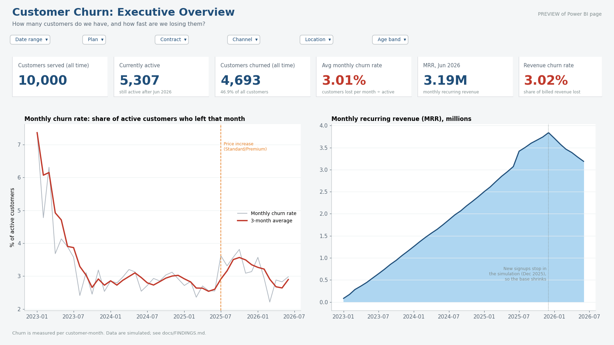
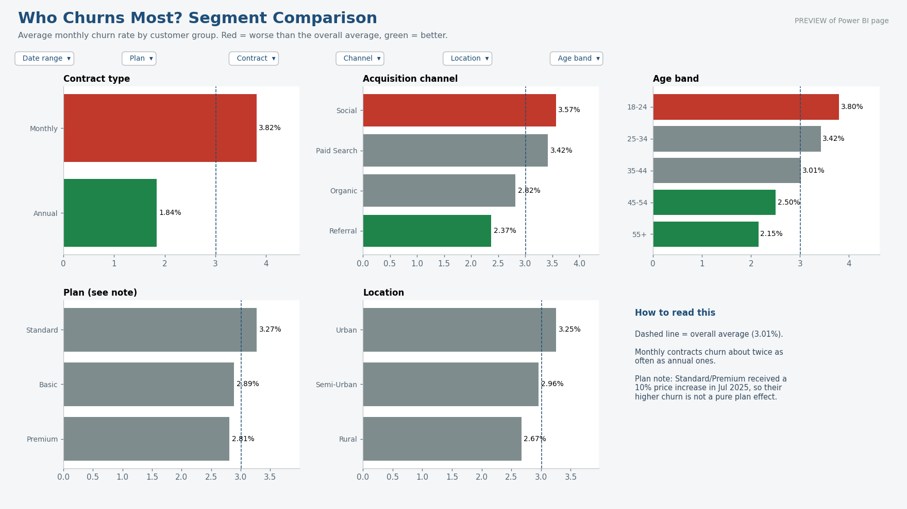
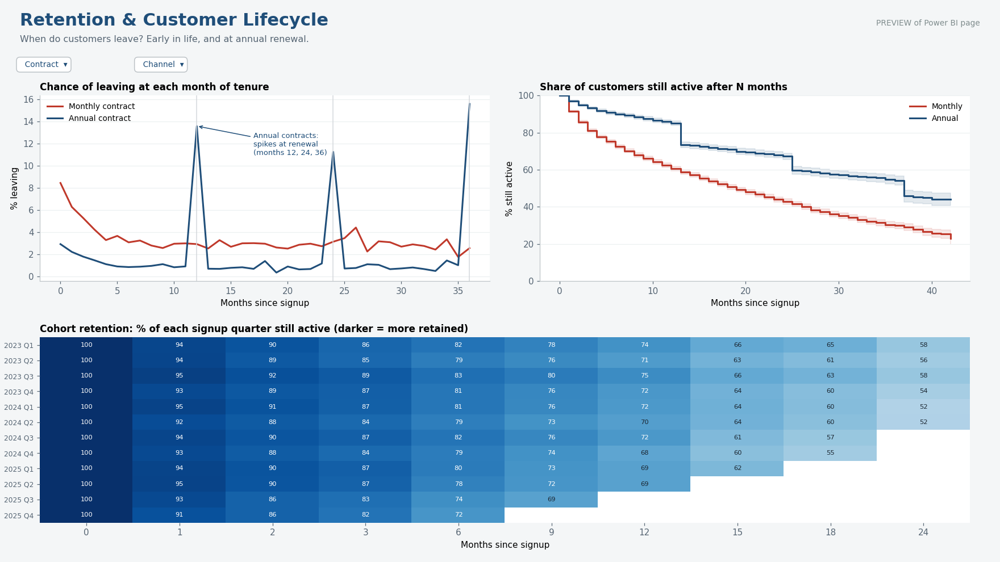
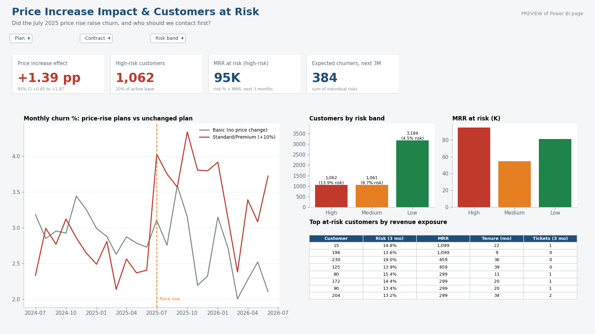
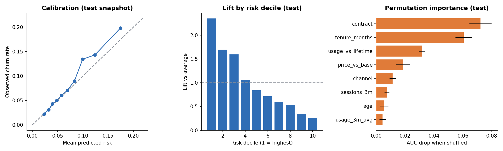

# Customer Churn Analytics: SQL, Power BI and Python

An end-to-end churn analysis of a **simulated** subscription business (10,000 customers, 42 months, 156k customer-months). It answers a set of business questions with SQL, presents them in a Power BI dashboard built for non-technical readers, and backs the recommendations with survival analysis, a price-change estimate and a leakage-tested prediction model.

> **Data note.** The data are simulated with a known churn mechanism so every method can be checked against the truth. Nothing here describes real customers, and the findings are findings about this simulated business. See [`docs/FINDINGS.md`](docs/FINDINGS.md) for methods and limitations.



## Business questions

| # | Question | Where it is answered |
|---|---|---|
| 1 | What is our churn rate and how is it trending? | Dashboard p.1, `sql/03_kpis.sql` |
| 2 | How many customers and how much revenue do we have? | Dashboard p.1, `sql/05_revenue.sql` |
| 3 | Which customer groups churn most? | Dashboard p.2, `churn_by_dimension` |
| 4 | When in the lifetime do customers leave? | Dashboard p.3, `hazard_by_tenure`, `cohort_retention` |
| 5 | Did the July 2025 price increase raise churn? | Dashboard p.4, difference-in-differences |
| 6 | Which live customers should we contact first? | Dashboard p.4, `sql/06_features.sql` + model |

The full list of 11 questions, each mapped to its query, dashboard page and answer, is in [`docs/BUSINESS_QUESTIONS.md`](docs/BUSINESS_QUESTIONS.md).

## Power BI dashboard

Four pages with the same slicers on each (date range, plan, contract, channel, location, age band), plain-language titles and "how to read this" notes.

| Page | Shows |
|---|---|
| 1. Executive overview | Customers served / active / churned, monthly churn rate with 3-month average, MRR, revenue churn |
| 2. Segment comparison | Churn by contract, channel, age band, plan, location; red/green against the overall average |
| 3. Retention and lifecycle | Churn by month of tenure, survival curves, cohort retention matrix |
| 4. Price impact and at-risk | Price-increase effect, risk bands, MRR at risk, top at-risk customers |





> **The images above are previews, not Power BI captures.** They are rendered from the exact tables and measure logic in the Power BI model (`powerbi/render_previews.py`). Power BI files cannot be generated outside Power BI Desktop, so the repo ships the full model and a build guide instead: [`powerbi/BUILD_GUIDE.md`](powerbi/BUILD_GUIDE.md). Replace these with real screenshots after building (step 9 of the guide).

What is in `powerbi/`:

| File | Purpose |
|---|---|
| `dataset/*.csv` | Star schema: `dim_customer`, `dim_date`, `fact_customer_month`, plus `at_risk_customers`, `hazard_by_tenure`, `cohort_retention`, `survival_curves`, `price_event_study` |
| `power_query.m` | Loaders for all 8 tables, driven by one folder parameter |
| `measures.dax` | 30 documented measures (churn, revenue, price effect, at-risk, dynamic titles) |
| `theme.json` | Colours and fonts |
| `BUILD_GUIDE.md` | Relationships, visuals per page, and the numbers to check |
| `build_powerbi_data.py` | Regenerates `dataset/` from the pipeline output |

`tests/test_powerbi_data.py` asserts that the Power BI tables reproduce the SQL results (monthly KPIs, all five segment cuts, the DiD logic) so the dashboard cannot silently disagree with the analysis.

## Setup

**Requirements:** Python 3.10+; Power BI Desktop (Windows) for the dashboard.

```bash
pip install -r requirements.txt
python -m churn_platform.pipeline        # simulate, load SQL, run all analyses, write outputs/ (~25 s)
python powerbi/build_powerbi_data.py     # build powerbi/dataset/ (already committed)
python powerbi/render_previews.py        # regenerate the preview images
pytest                                   # 51 tests
streamlit run dashboard/app.py           # optional: Python dashboard with a campaign simulator
```

`make all` runs the pipeline and tests; `make powerbi` rebuilds the Power BI tables and previews.

**Power BI:** follow [`powerbi/BUILD_GUIDE.md`](powerbi/BUILD_GUIDE.md): set the `DatasetFolder` parameter, paste the queries from `power_query.m`, create three relationships, paste the measures, apply the theme, build the four pages.

## SQL queries

All queries are standard SQL (CTEs, window functions, `CASE`) in `sql/`, executed on SQLite and documented inline.

| File | Contents |
|---|---|
| `01_schema.sql` | Two tables with `PRIMARY KEY`, `FOREIGN KEY`, `CHECK` constraints and indexes |
| `02_data_quality.sql` | 7 checks (orphans, rows after churn, gaps, flag mismatches...); the pipeline stops if any fails |
| `03_kpis.sql` | Monthly KPIs with 3-month rolling churn, churn by segment, hazard by tenure, usage deciles |
| `04_cohorts.sql` | Cohort retention with a right-censoring guard; 90-day churn by channel |
| `05_revenue.sql` | MRR waterfall that reconciles exactly; revenue by segment; concentration |
| `06_features.sql` | Point-in-time feature table for the prediction model |

Run any named query:

```bash
python - <<'PY'
from churn_platform.db import build_db, load_queries, run
from churn_platform.config import DATA_DIR
con, q = build_db(DATA_DIR, ":memory:"), load_queries()
print(run(con, q, "churn_by_dimension"))
PY
```

Example, the segment comparison behind dashboard page 2. It divides churners by customer-months, not by customers, because groups are observed for different lengths of time:

```sql
SELECT contract, COUNT(*) AS customers, SUM(is_churned) AS churned,
       ROUND(100.0 * SUM(is_churned) / SUM(observed_months), 2) AS monthly_churn_pct
FROM customers GROUP BY contract;
```

| contract | customers | churned | monthly_churn_pct |
|---|---|---|---|
| Annual | 3,520 | 1,181 | 1.84 |
| Monthly | 6,480 | 3,512 | 3.82 |

## Key findings

| | |
|---|---|
| Overall churn | 3.01% of active customers leave each month; 46.9% of customers have churned to date |
| Contract | Monthly 3.82% vs annual 1.84% per month; 12-month survival 60.6% vs 85.1% |
| Annual renewals | Annual churn is about 1% in ordinary months but 13.6% / 11.3% / 15.6% at months 12 / 24 / 36 |
| Early life | Monthly-contract hazard is 8.5% in month 1 and falls to about 3% by month 6 |
| Channel | 90-day churn: Referral 11.2%, Organic 13.8%, Paid Search 16.0%, Social 17.4% |
| Age | 3.80% (18-24) falling steadily to 2.15% (55+) |
| Price increase | +1.39 pp monthly churn on Standard/Premium (95% CI +0.85 to +1.87) |
| Prediction | Out-of-time AUC 0.693; top 20% of scores contain 40.7% of churners; moderately useful, not strong |

Plan differences (Standard 3.27% vs Premium 2.81%) are confounded by the price increase and should not be read as a plan effect. Location differences are small.

## Recommendations

Each is tied to a result above. Because the data are simulated, treat them as how I would reason on real data, and note the stated caveat.

1. **Convert monthly customers to annual, starting in the first three months.** Monthly contracts churn at twice the annual rate and lose 8.5% of customers in month 1. *Caveat:* customers chose their contract, so part of the gap is selection; pilot an annual-plan offer before assuming the full gap is recoverable.
2. **Build a renewal programme for annual customers.** Nearly all annual churn happens in renewal months (11% to 16% vs about 1%). Contact accounts 60 to 90 days before renewal. *Caveat:* the data cannot say which offer works; test it.
3. **Shift acquisition toward Referral and Organic.** Social and Paid Search customers are about 1.5x as likely to leave within 90 days as Referral. *Caveat:* no acquisition cost data, so this is a retention argument, not a full return-on-spend one.
4. **Be careful with price increases.** The 10% rise raised monthly churn on Standard/Premium by about 1.4 points, from roughly 2.5% to 3.9%. As an illustration only: if that persisted, expected customer lifetime would drop from about 40 to about 26 months, more than cancelling a 10% price gain. *Caveat:* only six months of post-data, and the estimate relies on parallel trends. Consider a staged or grandfathered rise.
5. **Use the risk scores in a randomised pilot, not a full rollout.** The model ranks risk moderately well (2.35x lift in the top decile), but whether outreach pays depends on a save rate the data cannot reveal. In the sensitivity table the best contact share swings from 2% to 62% as the assumed save rate moves from 5% to 30%. Hold out a control group and measure it.
6. **Do not treat low usage as a lever.** Churn is 4.3% in the lowest usage decile vs 1.4% in the highest, but usage is partly a symptom of dissatisfaction, so pushing usage up may not reduce churn.

## Methods behind the numbers

| Area | What is in it | Where |
|---|---|---|
| Survival analysis | Kaplan-Meier with Greenwood CIs and log-rank test, written from scratch and unit-tested | `survival.py` |
| Driver analysis | Hazard model compared with the true coefficients, showing omitted-variable bias | `hazard.py` |
| Prediction | Temporal split, baseline vs logistic vs gradient boosting, calibration, lift | `modeling.py` |
| Price effect | Difference-in-differences with cluster bootstrap and pre-trend check | `price_change.py` |
| Campaign value | Retention-campaign backtest with a sensitivity grid | `campaign.py` |
| Engineering | Seeded pipeline, 51 tests (leakage, SQL checks, Power BI parity, dashboard smoke test), Makefile | `tests/` |



## Repository layout

```
sql/                   schema, data-quality checks, KPIs, cohorts, revenue, features
churn_platform/        simulate, db, survival, hazard, modeling, segmentation, campaign, price_change, pipeline
powerbi/               Power BI model: dataset, Power Query, DAX, theme, build guide, preview renderer
dashboard/app.py       optional Streamlit dashboard
docs/                  FINDINGS.md, BUSINESS_QUESTIONS.md, screenshots/
outputs/               CSV tables and figures written by the pipeline
tests/                 simulation, SQL, leakage, analytics, Power BI parity, dashboard tests
```

## Limitations

Simulated data and one parameter set; SQL was run on SQLite only (PostgreSQL loader included but untested); hazard-model standard errors are not cluster-robust; the base shrinks after 2025-12 only because the simulation stops signups, which is not a business finding; the Power BI report must be built in Desktop from the included model (no `.pbix` is bundled). Full list in [`docs/FINDINGS.md`](docs/FINDINGS.md).

## Using real data

Map real tables onto `customers` and `customer_months`, rerun the SQL, survival and Power BI layers unchanged, and replace the simulator-only checks with holdout and randomised-test validation.
